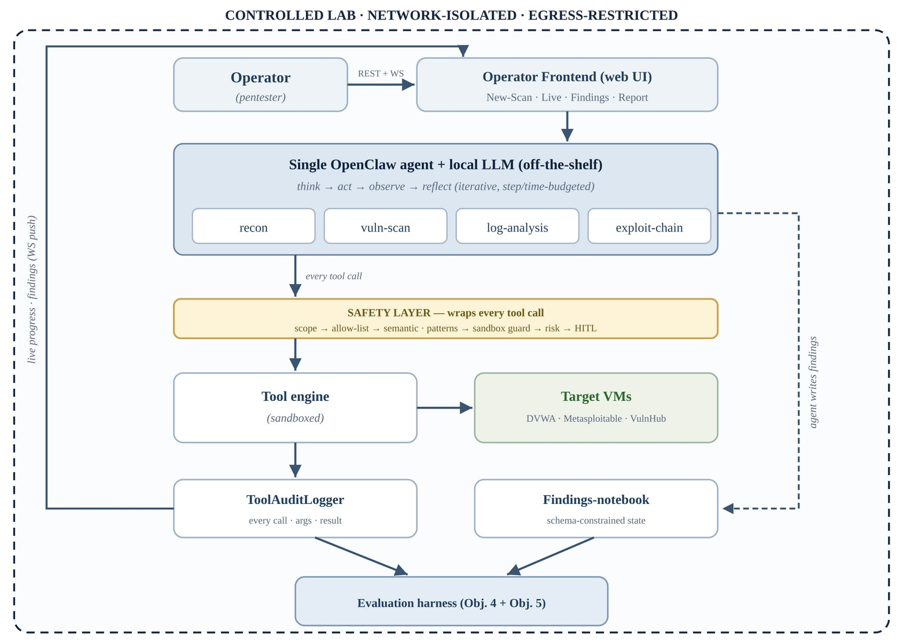
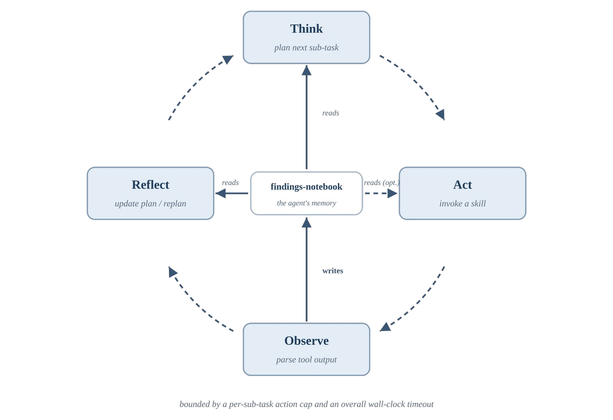

# Agentic AI for Cyber Security


An autonomous LLM agent for penetration testing and security operations, built on [OpenClaw](https://github.com/openclaw/openclaw) and running a fully local model inside a network-isolated lab. The project also turns the analysis on the agent itself: it threat-models the agent, hardens it, and measures how much each control actually reduces risk.

> BSc Computer Science Final Year Project, City University of Hong Kong (CS4514), Sep 2026 to Apr 2027. Supervised by Prof. Gerhard P. Hancke.

**Contents:** [Problem](#the-problem) · [Objectives](#objectives) · [Architecture](#architecture) · [Evaluation](#evaluation-approach) · [Progress](#progress-so-far) · [Roadmap](#roadmap) · [Background reading](#background-reading) · [Responsible use](#responsible-use)

---

## The problem

LLM agents can now plan, call tools and act with little supervision, which makes them attractive for routine security work: reconnaissance, scanning, log triage, exploit validation. Two questions are still poorly answered:

1. **How well does such an agent actually perform**, measured in a way that survives repeated runs rather than a single lucky attempt?
2. **What new risk does the agent introduce?** A security agent reads attacker-controlled content all day (banners, scan output, logs) while holding powerful tools, which makes it a near-ideal target for prompt injection and tool abuse.

Existing pentest agents mostly report single-run success rates, and existing OpenClaw security research treats it as a personal assistant. This project combines the two: **OpenClaw as an offensive tool, evaluated for reliability, and hardened against itself.**

## Objectives

| # | Objective | Realised by |
|---|---|---|
| O1 | Deploy a hardened, fully local, containerised OpenClaw instance | Bare-metal host hardening, Docker sandbox, network segmentation |
| O2 | Build custom security skills | Recon, vuln-scan, log-analysis and exploit-chain skills |
| O3 | Autonomous execution with human oversight | Agent loop, operator frontend, human approval of risky actions |
| O4 | Evaluate the agent reliably | Audit logger, evaluation harness, multi-run metrics |
| O5 | Threat-model, harden and measure the agent itself | Safety layer, canary credentials, adversarial scenario suite |

## Architecture



- **Single agent, not multi-agent.** One OpenClaw agent with role-specific skills (recon, vuln-scan, log-analysis, exploit-chain) and a reflect-and-replan loop. Coordination failures dominate multi-agent systems, and every extra agent enlarges the attack surface to be secured.
- **Local, off-the-shelf model** on a 20 GB GPU. No external API, which fits the no-internet lab and removes an outbound dependency.
- **Safety layer on every tool call.** Deterministic controls are primary: an operator-authored, agent-immutable scope file; a sandbox guard that resolves symlinks and paths before boundary checks; and human-in-the-loop approval for high-risk actions. Heuristic filters (pattern rules, semantic checks) are treated as a measured baseline, not as the main defence.
- **All tool output is untrusted.** Long output is summarised before it re-enters the model's context, and the agent's memory stores only schema-constrained fields, never raw tool output.
- **One audit stream, three uses.** A tool-audit logger records every call, argument, result and safety intervention. It feeds the operator UI's live view, the findings store and the evaluation harness.
- **Operator web frontend** (REST + WebSocket): define scope, watch progress, approve or reject risky actions, review findings, export reports.

<p align="center"></p>

### Design decisions at a glance

| Decision | Chosen | Rejected | Why |
|---|---|---|---|
| Agent topology | Single agent + iterative replanning | Multiple coordinating agents | Coordination is the dominant failure source; smaller attack surface |
| Model | Local open-weight, off-the-shelf | Cloud API; fine-tuned model | Isolated lab; 20 GB GPU rules out fine-tuning; keeps the security measurement clean |
| Primary safety controls | Scope enforcement, sandbox guard, human approval | Prompt- and pattern-based filtering alone | Adaptive attackers beat in-band filters |
| Agent memory | Structured task state + schema-constrained findings | Raw transcripts; RAG knowledge store | Limits context loss *and* stops injected text persisting |
| Skills | Hand-written, reviewed skills | Self-generated skills (e.g. self-improving agents) | Reproducible runs; no unreviewed capability growth |

## Evaluation approach

- **Reliability-aware metrics:** multiple seeded runs with mean ± std, solved-at-least-once vs solved-every-time, milestone progression, steps and wall-clock time, rather than a single binary pass/fail.
- **Trace auditing:** each claimed success is checked against the audit log to confirm it was a genuine exploit.
- **Before/after hardening:** benign utility, utility under attack and attack success rate, measured with adapted adversarial scenarios and planted canary credentials to detect leaks automatically.
- **Targets:** deliberately vulnerable machines only (DVWA, Metasploitable, VulnHub) on an isolated network.

## Progress so far

- **Lab host is live:** a dedicated GPU workstation running bare-metal Ubuntu Server with no desktop environment, to keep the attack surface small.
- **Baseline hardening applied:** key-only SSH with root and password login disabled, a default-deny firewall, automatic security updates without unattended reboots, and brute-force banning. A formal benchmark-based hardening pass comes next.
- **Container stack:** Docker Engine + Compose, matching the Docker-based threat models in the OpenClaw security literature.
- **Local model serving works:** the lead candidate (a mixture-of-experts model, ~30B parameters with ~3B active) runs fully on the GPU. Its serving API is bound to localhost only, because it has no authentication.
- **Design complete:** full preliminary design, use cases, test plan and traceability matrix submitted in Interim Report I (Oct 2026).

**Next:** isolate the lab network, then run the first skill and the audit logger end to end.

## Roadmap

| Phase | Timing | Status |
|---|---|---|
| Literature review, design, software-engineering & test plan | Sep-Oct 2026 | ✅ Done (Interim Report I) |
| Lab host, hardening baseline, local model serving | Oct-Nov 2026 | ✅ First increment done |
| Network isolation, first skill + audit logger end-to-end | Nov-Dec 2026 | 🔄 In progress |
| Remaining skills, findings store, evaluation harness | Jan-Feb 2027 | ⏳ Planned |
| Threat model, hardening, before/after measurement | Feb-Mar 2027 | ⏳ Planned |
| Final evaluation, operator frontend, report & demo | Mar-Apr 2027 | ⏳ Planned |

## Tech stack

OpenClaw · local open-weight LLM (MoE) · Docker Engine / Compose · Ubuntu Server · Python · web frontend over REST + WebSocket · Kali tooling (Nmap and friends)

## Repository layout

```
docs/
  figures/     architecture and design diagrams
  reports/     project reports (published after assessment)
```

Code (skills, safety layer, audit logger, evaluation harness, frontend) will be added as each increment lands.

## Background reading

Work this project builds on most directly:

- **PentestGPT**: Deng et al., USENIX Security 2024. [arXiv:2308.06782](https://arxiv.org/abs/2308.06782)
- **xOffense**: Luong et al., 2025. [arXiv:2509.13021](https://arxiv.org/abs/2509.13021)
- **Why Do Multi-Agent LLM Systems Fail?**: Cemri et al., NeurIPS 2025 Datasets & Benchmarks. [arXiv:2503.13657](https://arxiv.org/abs/2503.13657)
- **Indirect prompt injection**: Greshake et al., AISec 2023. [arXiv:2302.12173](https://arxiv.org/abs/2302.12173)
- **AgentDojo**: Debenedetti et al., NeurIPS 2024 Datasets & Benchmarks. [arXiv:2406.13352](https://arxiv.org/abs/2406.13352)
- **MATRA: attack-surface modelling of OpenClaw**: Van hamme et al., 2026. [arXiv:2605.10763](https://arxiv.org/abs/2605.10763)
- **Security analysis and defence framework for OpenClaw**: Shan et al., 2026. [arXiv:2603.10387](https://arxiv.org/abs/2603.10387)
- **PASB: benchmarking attacks on OpenClaw**: Wang et al., 2026. [arXiv:2602.08412](https://arxiv.org/abs/2602.08412)

## Responsible use

All testing happens in an isolated lab against intentionally vulnerable targets. This repository publishes methodology, skills and configuration; it does not bundle OpenClaw itself, and it will not include real findings or drop-in exploit code. Do not point anything here at systems you are not authorised to test.

## Acknowledgements

Supervised by Prof. Gerhard P. Hancke, Department of Computer Science, City University of Hong Kong. Built on the open-source [OpenClaw](https://github.com/openclaw/openclaw) project (MIT).

## Author

**Muhammad Mahad**, BSc Computer Science, City University of Hong Kong · [@muhammadmahad4](https://github.com/muhammadmahad4)
